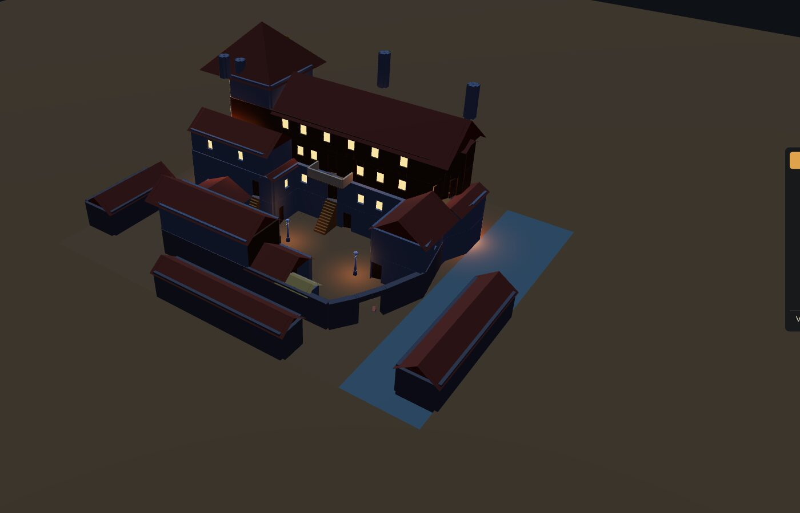
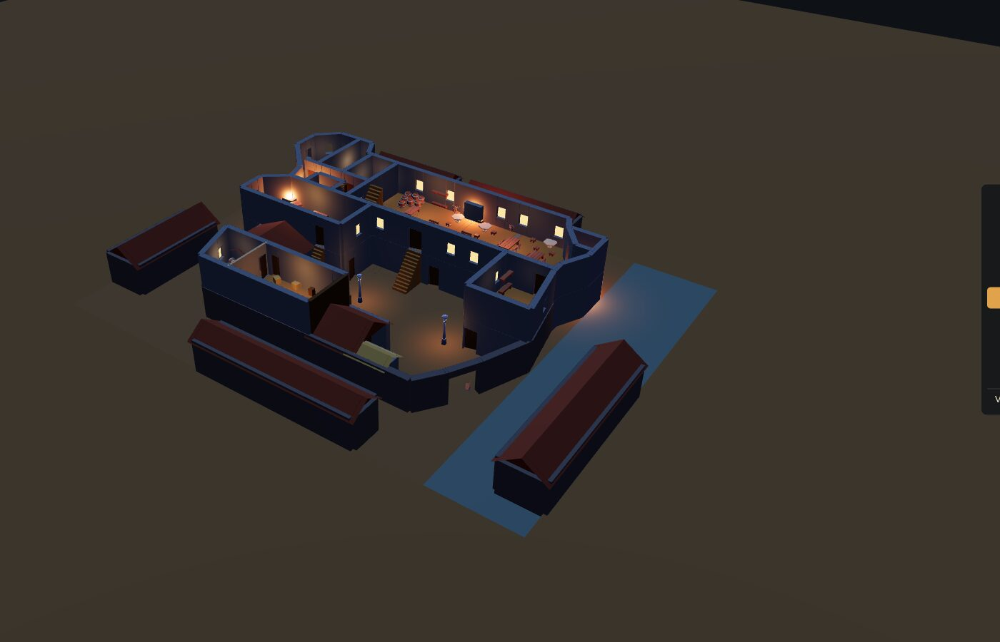

# L'auberge de l'Épée en 3D

Une maquette de l'auberge de l'Épée (*Pax Elfica*, Les XII Singes) à montrer aux joueurs sur
l'écran de la table. On la fait tourner, on retire les étages un par un, et chaque pièce est
meublée. Les murs suivent les plans officiels à 25 cm près ; le reste est du bas-poly éclairé comme
une taverne au crépuscule.

En ligne : <https://silvrduck.github.io/pax-elfica-3d-buildings/>




Huit niveaux : les deux étages du silo, le rez-de-chaussée avec la cour et les maisons voisines,
le premier, le deuxième, le troisième, le sommet de la tour, les toits. Les 39 pièces numérotées
dans le livre de base (pages 40 à 42) sont toutes là.

## À la table

| Geste | Effet |
|---|---|
| glisser, molette, clic droit | tourner, zoomer, déplacer |
| liste à droite, ou `↑` `↓` | choisir l'étage ; ce qui est au-dessus disparaît |
| « Vue d'ensemble » | revenir à la caméra de départ |
| `N` | afficher le nom des pièces de l'étage choisi |
| `C` | projeter le plan officiel sur le sol de l'étage choisi (voir plus bas) |
| `F` | compteur d'images et d'appels de rendu |

Une adresse peut ouvrir la maquette dans un état donné, par exemple
`?level=e1&labels=1` ou `?level=rdc&view=top` pour une vue d'en haut.

## Lancer chez soi

```sh
npm install
npm run dev
```

puis ouvrir l'adresse affichée. `npm run build` produit un dossier `dist/` à copier sur le portable
de la table. Il faut Node 20 ou plus.

## Ce que le dépôt ne contient pas

Le dépôt est public et ne contient rien qui appartienne aux XII Singes.

Les trois planches de plans de l'auberge, vendues avec le jeu, sont attendues dans
`../../Officiel/Plans_batiments/` (ou dans le dossier donné par la variable `PLANS_DIR`). Elles ne
servent qu'à `node tools/calibrate.mjs`, qui en découpe les calques affichés par la touche `C` dans
`public/plans/`, dossier ignoré par git. Sans elles tout fonctionne, la touche `C` n'affiche rien.

Les meubles viennent de packs CC0 de KayKit et Kenney. Les pièces utilisées sont dans
`public/assets/`, avec leurs licences dans `LICENSES.md`. `tools/fetch-assets.sh` télécharge les
packs complets dans `vendor/` si l'on veut en ajouter.

## Modifier la maquette

Chaque niveau est décrit par `src/data/levels/<niveau>.json` : murs, portes et fenêtres, sols,
escaliers, pièces, meubles, lumières, toits, en mètres. Ces fichiers sont produits par les scripts
de `tools/levels/`, écrits en cases des plans (une case fait 1,5 m). On corrige le script, on le
relance, on vérifie sur le plan :

```sh
node tools/levels/e1.mjs
node tools/grid-view.mjs e1 8 2 10 8 --walls
```

La seconde commande rend le plan quadrillé avec les murs du modèle par-dessus, dans `verification/`.

```sh
npm test               # géométrie, schéma des niveaux, calibration
npm run test:legend    # chaque pièce de la légende est présente une fois
npm run shots          # une capture de chaque niveau dans verification/
```

Les captures passent par Chromium (`/usr/bin/chromium`, ou le chemin donné par `CHROMIUM`).
